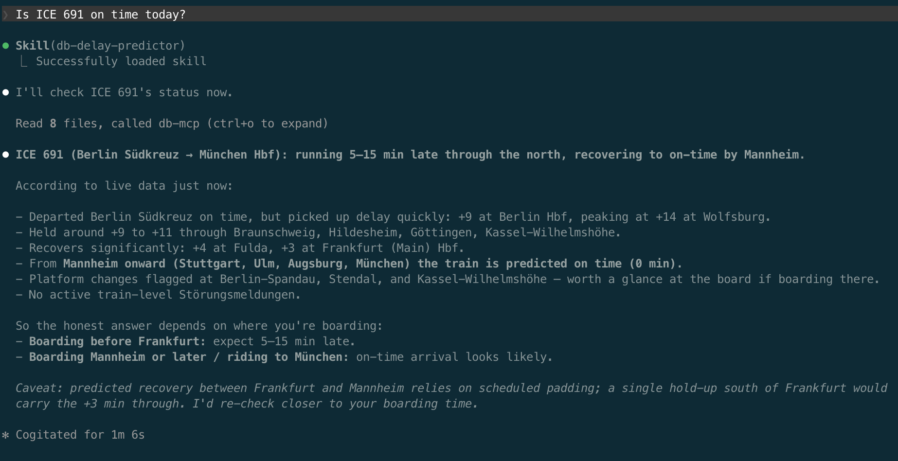

# Where's My DB?

*A Claude skill + MCP server that tells you **how** Deutsche Bahn delays will affect your trip — not just whether your train is late.*

---

## What it does

Knowing a train is "5 min late" isn't useful. Knowing that the 12-minute delay three stops up the line will eat your 9-minute transfer in Berlin — that's useful.

**Where's My DB?** turns *"is my train on time?"* into a real answer. You ask Claude in plain language and it walks the upstream stops, traces the connection chain, and tells you which delays actually affect *your* journey:

> **Likely 15–18 minutes late.**
> - ICE 597 was already 18 min late at Solingen Hbf (three stops upstream) at 15:42.
> - No scheduled padding before your boarding station at 16:02.
> - Your Frankfurt connection (ICE 599) is currently on time — you'd lose ~14 min of a 16-min transfer.
>
> *Caveat: a single 5-min recovery en route can change this. The official board hasn't updated yet.*



It also draws the picture in plain text, so it shows up in any chat window or terminal:

```
49 of 434 trains late, 4 likely stuck
  +53 min  RE4 (26422)    Neuss Hauptbahnhof ●━━━━▶━━━━○ MG Hbf /Europaplatz
  +40 min  IC 2203        Düsseldorf Hbf ●━━━━▶━━━━○ Köln Hbf  ⚠ likely stuck
  +30 min  ICE 628        Köln Messe/Deutz Bf ●━━▶━━━━━━○ Düsseldorf Hbf  ⚠ likely stuck

RE4 (26422) → Aachen, Hbf  (live)
 ●  Wuppertal Hbf                  14:57  on time
 ●  Düsseldorf Hbf                 15:21  +55 min
 ●  Neuss Hauptbahnhof             15:36  +55 min
 ▼  train is around here
 ○  MG Hbf /Europaplatz            15:50  +53 min
 ○  Aachen, Hbf                    16:37  +53 min
```

---

## How it works

```
┌──────────────────────────────────────────────────────────┐
│  Claude (Code or Desktop)                                │
│  ┌────────────────────────────────────────────────────┐  │
│  │  Skill: db-delay-predictor                         │  │
│  │  Reasoning playbook: which tool, how to combine    │  │
│  │  signals, how to express confidence honestly.      │  │
│  └────────────────────────────────────────────────────┘  │
└──────────────────────────────────────────────────────────┘
                          │  MCP (stdio, JSON-RPC)
                          ▼
┌──────────────────────────────────────────────────────────┐
│  MCP server: db-mcp (TypeScript)                         │
│  Typed data access. No reasoning.                        │
│  ┌─────────────────────────────────────────────────┐     │
│  │ Transitous: stations, departures, per-stop      │     │
│  │ delays, journeys, trains in an area (realtime)  │     │
│  └─────────────────────────────────────────────────┘     │
│  ┌─────────────────────────────────────────────────┐     │
│  │ DWD: official weather warnings for a location   │     │
│  └─────────────────────────────────────────────────┘     │
│  + short in-memory cache                                 │
└──────────────────────────────────────────────────────────┘
```

Two artifacts. Clean split:

- **The MCP server** knows nothing about reasoning. It's typed access to live data.
- **The skill** knows nothing about API endpoints. It's a reasoning playbook in markdown.

Both are independently testable. Both ship in this repo.

---

## What's interesting under the hood

- **Live data for every kind of train.** Train data comes from [Transitous](https://transitous.org), an open, community-run service built on public timetable and realtime feeds. It covers long-distance, regional, S-Bahn, U-Bahn and tram, with the delay at every stop of a run.
- **Late and stuck trains in an area.** One tool lists the trains currently running late around a point, with an estimated position, and flags those losing 10+ minutes between two stops as likely stuck.
- **Optional DB notices.** With a free DB API key, answers also show what DB has posted for your train at your stop: delay reasons ("Repair to a signal"), missing catering, missing coaches, bike spaces, construction work. See [Using the DB API](#using-the-db-api-optional).
- **Weather context.** A separate client asks DWD (Deutscher Wetterdienst) for the official warnings covering a station's exact location, so the agent can explain delays and check conditions for a planned trip.
- **The skill is honest about uncertainty.** Delay predictions are rounded to 5-minute buckets ("about 10–15 minutes late") because precision would be theater. It says which signals it used, what could change, and when it only has timetable data.
- **7 atomic MCP tools, no reasoning baked in.** `resolve_station`, `get_departures`, `find_train`, `get_train_status`, `plan_journey`, `get_late_trains`, `get_weather_risk`. The skill composes them.
- **Diagrams as plain text.** A train's route and the late trains in an area come back as a metro-style text diagram, because text is the one format every agent and chat app can display.
- **A live map, as a link.** The same tools return a link to a small web page ([`docs/index.html`](./docs/index.html), served by GitHub Pages) that shows your train on a real map: the route, where the train is now, and your stop with the delay there. Tracks are emphasised, and streets and buildings appear as you zoom in. A second view shows the late trains around a station. It reads the live data in the browser, so there is no server to run, and it works on a phone.
- **Watch mode.** Ask the agent to keep you posted on a train or a connection. The skill tells it when to re-check and to message you only when something changes, using whatever scheduling and messaging your agent already has.
- **A live smoke check.** Unit tests mock the network, so `npm run smoke -w db-mcp` calls every tool against the real services and fails loudly when an upstream API changes.

---

## Quick start

Build it:

```bash
git clone https://github.com/<you>/wheres-my-db.git
cd wheres-my-db
npm install
npm run build
```

### Wire into Claude Code (terminal)

```bash
claude mcp add db-mcp -s user -- node "$PWD/packages/db-mcp/dist/index.js"
ln -s "$PWD/packages/skill-db-delay" ~/.claude/skills/db-delay-predictor
```

Open a `claude` session, run `/mcp` to confirm `db-mcp` is connected with 7 tools, then ask:

```
Is ICE 597 on time today?
```

### Wire into Claude Desktop

Edit `~/Library/Application Support/Claude/claude_desktop_config.json`:

```json
{
  "mcpServers": {
    "db-mcp": {
      "command": "node",
      "args": ["/absolute/path/to/wheres-my-db/packages/db-mcp/dist/index.js"]
    }
  }
}
```

Then symlink the skill the same way and fully quit + relaunch Claude Desktop.

### Wire into Codex CLI

OpenAI's Codex CLI speaks MCP. Edit `~/.codex/config.toml` (create it if missing) and add:

```toml
[mcp_servers.db-mcp]
command = "node"
args = ["/absolute/path/to/wheres-my-db/packages/db-mcp/dist/index.js"]
```

Restart `codex`. The 7 tools (`resolve_station`, `get_departures`, `find_train`, `get_train_status`, `plan_journey`, `get_late_trains`, `get_weather_risk`) become callable from any session.

Codex doesn't load `SKILL.md` automatically. To get the reasoning playbook, paste the contents of `packages/skill-db-delay/SKILL.md` into your project's `AGENTS.md` or the Codex system-prompt equivalent. (Verify the exact mechanism against current Codex docs — the config schema has shifted across versions.)

### Wire into opencode

[opencode](https://opencode.ai) also speaks MCP. Edit `~/.config/opencode/opencode.json` (global) or a project-local `opencode.json`:

```json
{
  "mcp": {
    "db-mcp": {
      "type": "local",
      "command": ["node", "/absolute/path/to/wheres-my-db/packages/db-mcp/dist/index.js"],
      "enabled": true
    }
  }
}
```

Restart opencode. Same 7 tools become available.

For the reasoning playbook: copy the body of `packages/skill-db-delay/SKILL.md` into your project's `AGENTS.md` (opencode's instruction file) or use it as the system prompt.

### Wire into Hermes Agent

[Hermes Agent](https://github.com/NousResearch/hermes-agent) by Nous Research speaks MCP natively and — unlike Codex and opencode — supports the [agentskills.io](https://agentskills.io) open standard, which is the same format `SKILL.md` uses. The skill auto-loads, no system-prompt copy-paste needed.

Add the MCP to `~/.hermes/config.yaml`:

```yaml
mcp_servers:
  db-mcp:
    command: "node"
    args: ["/absolute/path/to/wheres-my-db/packages/db-mcp/dist/index.js"]
```

Then install the skill by symlinking the same way as for Claude:

```bash
mkdir -p ~/.hermes/skills
ln -s "$PWD/packages/skill-db-delay" ~/.hermes/skills/db-delay-predictor
```

Run `hermes chat` and ask:

```
Is ICE 597 on time today?
```

### Any other MCP client

The server is a stdio MCP — it speaks JSON-RPC over stdin/stdout per the [Model Context Protocol spec](https://modelcontextprotocol.io). Any client that implements MCP can use it. The shape is always roughly the same: a command + args pointing at `packages/db-mcp/dist/index.js`. The skill is Claude-specific in its frontmatter format, but its prose transfers cleanly into any system-prompt or custom-instructions slot.

---

## Using the DB API (optional)

Everything above works without any account. If you add a free key for Deutsche Bahn's own timetable API, answers about your train also show the notices DB has posted for it at your stop, the small things that add up:

```
DB notices at Hamm (Westf), Hauptbahnhof:
 • Repair to a signal
 • Delay from its previous journey
 • No food or drink available
```

These include delay reasons, catering, missing or reordered coaches, seat reservations, bike spaces, accessibility and construction work. Without a key you simply don't get this list; nothing else changes.

### 1. Get a free key

1. Register at the [DB API Marketplace](https://developers.deutschebahn.com/db-api-marketplace/apis/start). It uses a DB customer account (the same as a bahn.de login) and confirms your email with a code.
2. Create an application ("Neue Anwendung erstellen"). Only the title is required; leave the certificate and redirect URL empty.
   - If saving fails with an error about `application_public_certificate_entry`, paste a throwaway certificate into the certificate field. It is never used for this API. To make one: `openssl req -x509 -newkey rsa:2048 -nodes -keyout key.pem -out cert.pem -days 730 -subj "/CN=wheres-my-db"`, then paste the contents of `cert.pem`.
3. Copy the **Client ID** and the **Client Secret**. The secret is shown only once.
4. In the catalogue, open **Timetables**, choose the **Free** plan, click **Abonnieren** (subscribe) and select your application.

### 2. Add the key

**Option A: the setup command (recommended).** In a terminal, in this repository:

```bash
npm run setup-db-api
```

It asks for the Client ID and the Client Secret (hidden as you type), checks them with DB, and saves them to `~/.config/wheres-my-db/db-api.json`, readable only by you. This works for every agent, because the server reads that file itself. Restart your agent afterwards.

**Option B: environment variables in your agent's config.** The server also reads `DB_CLIENT_ID` and `DB_API_KEY`. For Claude Code:

```bash
claude mcp add db-mcp -s user -e DB_CLIENT_ID=your-client-id -e DB_API_KEY=your-client-secret -- node "$PWD/packages/db-mcp/dist/index.js"
```

For Claude Desktop, add an `env` block next to `command` and `args`:

```json
"env": { "DB_CLIENT_ID": "your-client-id", "DB_API_KEY": "your-client-secret" }
```

Codex, opencode and Hermes have an equivalent environment setting in their MCP config.

Environment variables win over the saved file. While developing, a `.env` file at the repository root with the same two names also works; git ignores it.

**Why a terminal command and not something you tell the agent?** Typing the key into a chat would send it through the AI conversation and its logs. The setup command keeps it on your machine.

### 3. Check or remove it

```bash
npm run db-api-status
```

This says where the key was found and whether DB accepts it, without printing it. To delete the saved key: `node packages/db-mcp/dist/index.js remove-db-api`.

### Good to know

- **Limits:** the free plan allows 60 calls a minute. Lookups are cached (a station's notices for one minute), which is plenty for personal use.
- **Scope:** notices are fetched for the stop where you board, when the agent knows it.
- **Each user needs their own key.** Keys are personal; don't put yours in the repository or share it.
- **Change ahead:** DB has announced that this API will be replaced by a new one ("OpenBoards"); the client may need updating when that happens.
- **Licence:** DB publishes this data under [CC BY 4.0](https://creativecommons.org/licenses/by/4.0/). Credit: Deutsche Bahn AG.

---

## Repo layout

```
packages/
├── db-mcp/                  TypeScript MCP server
│   ├── src/
│   │   ├── server.ts        wiring + cache integration
│   │   ├── tools/           one file per MCP tool
│   │   ├── clients/         Transitous (trains), DWD (weather), DB Timetables (notices)
│   │   ├── db/              DB message codes and key handling
│   │   ├── setup-db-api.ts  terminal commands to save, check and remove the DB key
│   │   ├── render.ts        plain-text route and late-train diagrams
│   │   ├── map-link.ts      links to the live map page
│   │   ├── cache.ts         LRU
│   │   └── types.ts         normalized domain types
│   ├── scripts/smoke.mjs    live check against the real services
│   └── tests/               vitest + msw
└── skill-db-delay/
    └── SKILL.md             the reasoning playbook
docs/index.html              the live map page (GitHub Pages)
```

---

## Test it

```bash
npm test
```

Tests cover the cache, the data clients, key handling, the tools, and server wiring. Network calls are mocked via [msw](https://mswjs.io), using trimmed real responses as fixtures; failure modes (timeout, 5xx, malformed bodies) are part of the test surface.

To check the real services are still reachable and shaped as expected:

```bash
npm run smoke -w db-mcp
```

---

## Credits

- [Transitous](https://transitous.org) — the open, community-run transit API (built on [MOTIS](https://github.com/motis-project/motis)) that provides all train data. Please use it considerately.
- [OpenFreeMap](https://openfreemap.org) and [OpenStreetMap](https://www.openstreetmap.org/copyright) contributors — the basemap of the live map, drawn with [MapLibre](https://maplibre.org).
- [Deutsche Bahn AG](https://developers.deutschebahn.com) — the optional notices come from DB's Timetables API (CC BY 4.0). The message code list follows DB's own and was cross-checked against [Travel-Status-DE-IRIS](https://github.com/derf/Travel-Status-DE-IRIS) by Birte Kristina Friesel.
- [DWD (Deutscher Wetterdienst)](https://www.dwd.de) — Germany's official weather service, source of the weather warnings.

## License

MIT
