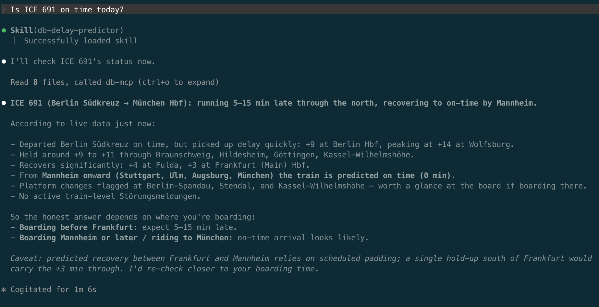

# Where's My DB?

*A Claude skill + MCP server that tells you **how** Deutsche Bahn delays will affect your trip — not just whether your train is late.*

---

## What it does

Knowing a train is "5 min late" isn't useful. Knowing that the 12-minute delay three stops up the line will eat your 9-minute transfer in Berlin — that's useful.

**Where's My DB?** turns *"is my train on time?"* into a real answer. You ask Claude in plain language and it walks the upstream stops, traces the connection chain, and tells you which delays actually affect *your* journey:

> **Likely 15–18 minutes late.**
> - ICE 597 was already 18 min late at Solingen Hbf (three stops upstream) at 15:42.
> - No scheduled padding before your boarding station at 16:02.
> - Your Frankfurt connection (ICE 599) is currently on time — you'd lose ~14 min of a 16-min transfer.
>
> *Caveat: a single 5-min recovery en route can change this. The official board hasn't updated yet.*



See [`examples/`](./examples/) for three full transcripts.

---

## How it works

```
┌──────────────────────────────────────────────────────────┐
│  Claude (Code or Desktop)                                │
│  ┌────────────────────────────────────────────────────┐  │
│  │  Skill: db-delay-predictor                         │  │
│  │  Reasoning playbook: which tool, how to combine    │  │
│  │  signals, how to express confidence honestly.      │  │
│  └────────────────────────────────────────────────────┘  │
└──────────────────────────────────────────────────────────┘
                          │  MCP (stdio, JSON-RPC)
                          ▼
┌──────────────────────────────────────────────────────────┐
│  MCP server: db-mcp (TypeScript)                         │
│  Typed data access. No reasoning.                        │
│  ┌─────────────────────┐    ┌─────────────────────┐      │
│  │ marudor (primary)   │ →  │ db-rest (fallback)  │      │
│  │ tRPC + devalue      │    │ plain REST          │      │
│  └─────────────────────┘    └─────────────────────┘      │
│  ┌─────────────────────────────────────────────────┐     │
│  │ DWD weather warnings (independent source)       │     │
│  └─────────────────────────────────────────────────┘     │
│  + 5-min in-memory LRU cache                             │
└──────────────────────────────────────────────────────────┘
```

Two artifacts. Clean split:

- **The MCP server** knows nothing about reasoning. It's typed data access with transparent provider fallback.
- **The skill** knows nothing about API endpoints. It's a reasoning playbook in markdown.

Both are independently testable. Both ship in this repo.

---

## What's interesting under the hood

- **The primary data source isn't a public REST API.** Marudor (the community DB tracker) runs internal tRPC with custom [devalue](https://github.com/Rich-Harris/devalue) encoding. The MCP includes a hand-rolled tRPC transport that speaks it, because no public alternative exposes per-stop connection-chain data ("will my Anschluss be held?") — which is the whole point.
- **Transparent fallback to a stable REST API.** If marudor fails (it's an unofficial endpoint), the MCP transparently falls back to [db-rest](https://github.com/derhuerst/db-rest), and the skill tells the user the answer is degraded. Belt-and-suspenders engineering, not a hedge.
- **External weather context.** A separate `WeatherClient` pulls live warnings from DWD (Deutscher Wetterdienst) — heatwave, storm, snow — so the agent can explain delays the DB feed hasn't acknowledged yet, and proactively warn about future trips through affected corridors.
- **The skill is honest about uncertainty.** Delay predictions are rounded to 5-minute buckets ("about 10–15 minutes late") because precision would be theater. The skill explicitly enumerates which signals fired and what could change.
- **6 atomic MCP tools, no reasoning baked in.** `resolve_station`, `find_train`, `get_train_status`, `plan_journey`, `get_disruptions`, `get_weather_risk`. The skill composes them.
- **52 tests, mostly with mocked HTTP.** Includes failure modes: timeout → fallback, both providers down → clean error, partial failure on a single stop's connection chain doesn't break the whole call.

---

## Quick start

Build it:

```bash
git clone https://github.com/<you>/wheres-my-db.git
cd wheres-my-db
npm install
npm run build
```

### Wire into Claude Code (terminal)

```bash
claude mcp add db-mcp -s user -- node "$PWD/packages/db-mcp/dist/index.js"
ln -s "$PWD/packages/skill-db-delay" ~/.claude/skills/db-delay-predictor
```

Open a `claude` session, run `/mcp` to confirm `db-mcp` is connected with 5 tools, then ask:

```
Is ICE 597 on time today?
```

### Wire into Claude Desktop

Edit `~/Library/Application Support/Claude/claude_desktop_config.json`:

```json
{
  "mcpServers": {
    "db-mcp": {
      "command": "node",
      "args": ["/absolute/path/to/wheres-my-db/packages/db-mcp/dist/index.js"]
    }
  }
}
```

Then symlink the skill the same way and fully quit + relaunch Claude Desktop.

### Wire into Codex CLI

OpenAI's Codex CLI speaks MCP. Edit `~/.codex/config.toml` (create it if missing) and add:

```toml
[mcp_servers.db-mcp]
command = "node"
args = ["/absolute/path/to/wheres-my-db/packages/db-mcp/dist/index.js"]
```

Restart `codex`. The 5 tools (`resolve_station`, `find_train`, `get_train_status`, `plan_journey`, `get_disruptions`) become callable from any session.

Codex doesn't load `SKILL.md` automatically. To get the reasoning playbook, paste the contents of `packages/skill-db-delay/SKILL.md` into your project's `AGENTS.md` or the Codex system-prompt equivalent. (Verify the exact mechanism against current Codex docs — the config schema has shifted across versions.)

### Wire into opencode

[opencode](https://opencode.ai) also speaks MCP. Edit `~/.config/opencode/opencode.json` (global) or a project-local `opencode.json`:

```json
{
  "mcp": {
    "db-mcp": {
      "type": "local",
      "command": ["node", "/absolute/path/to/wheres-my-db/packages/db-mcp/dist/index.js"],
      "enabled": true
    }
  }
}
```

Restart opencode. Same 5 tools become available.

For the reasoning playbook: copy the body of `packages/skill-db-delay/SKILL.md` into your project's `AGENTS.md` (opencode's instruction file) or use it as the system prompt.

### Wire into Hermes Agent

[Hermes Agent](https://github.com/NousResearch/hermes-agent) by Nous Research speaks MCP natively and — unlike Codex and opencode — supports the [agentskills.io](https://agentskills.io) open standard, which is the same format `SKILL.md` uses. The skill auto-loads, no system-prompt copy-paste needed.

Add the MCP to `~/.hermes/config.yaml`:

```yaml
mcp_servers:
  db-mcp:
    command: "node"
    args: ["/absolute/path/to/wheres-my-db/packages/db-mcp/dist/index.js"]
```

Then install the skill by symlinking the same way as for Claude:

```bash
mkdir -p ~/.hermes/skills
ln -s "$PWD/packages/skill-db-delay" ~/.hermes/skills/db-delay-predictor
```

Run `hermes chat` and ask:

```
Is ICE 597 on time today?
```

### Any other MCP client

The server is a stdio MCP — it speaks JSON-RPC over stdin/stdout per the [Model Context Protocol spec](https://modelcontextprotocol.io). Any client that implements MCP can use it. The shape is always roughly the same: a command + args pointing at `packages/db-mcp/dist/index.js`. The skill is Claude-specific in its frontmatter format, but its prose transfers cleanly into any system-prompt or custom-instructions slot.

---

## Repo layout

```
packages/
├── db-mcp/                  TypeScript MCP server
│   ├── src/
│   │   ├── server.ts        wiring + cache integration
│   │   ├── tools/           one file per MCP tool
│   │   ├── clients/         marudor (tRPC) + db-rest + provider router
│   │   ├── cache.ts         LRU
│   │   └── types.ts         normalized domain types
│   └── tests/               vitest + msw
└── skill-db-delay/
    └── SKILL.md             the reasoning playbook
examples/                    saved demo transcripts
```

---

## Test it

```bash
npm test
```

52 tests across cache, provider clients, fallback routing, tool wrappers, and server wiring. Network calls are mocked via [msw](https://mswjs.io); failure modes (timeout, 5xx, partial collapse) are part of the test surface, not afterthoughts.

---

## Status

**v0.1** — usable. Connection-chain prediction works end-to-end against live marudor data.

Known limitations:
- Marudor's internal tRPC isn't a public contract; if they change it, the MCP will fall back to db-rest automatically with degraded data and the skill will tell you so.
- `bahn.routing` (the journey-search procedure inside marudor) occasionally returns 5xx upstream from DB itself; this is reflected as a transparent fallback to db-rest's `/journeys`.

## Stretch goals (not in v0.1)

- **Loop skill** for monitoring a specific train at an interval.
- **Hosted HTTP MCP** with SSE transport, so it can be added by URL instead of cloned.
- **Historical baseline collector** — per-train on-time stats over weeks, used as a fifth prediction signal.

---

## Credits

- [marudor / bahn.expert](https://bahn.expert) — the data source that makes the connection-chain feature possible. Without it this project doesn't exist.
- [db-rest](https://github.com/derhuerst/db-rest) by Jannis R — the stable REST fallback.
- [DWD (Deutscher Wetterdienst)](https://www.dwd.de) — Germany's official weather service. Their public warnings JSON drives the weather-context signal.

## License

MIT
